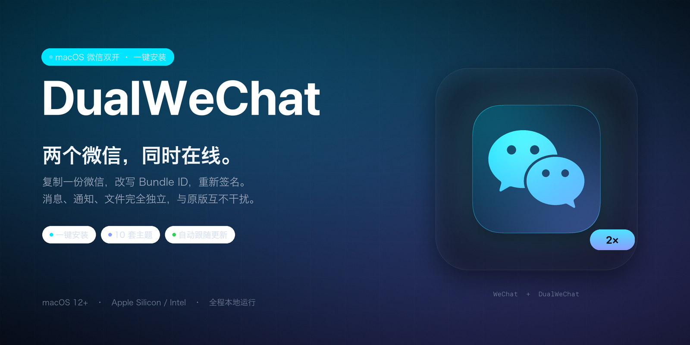
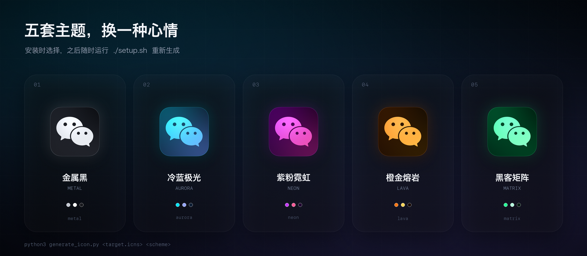

<div align="center">



<br />

<a href="https://github.com/MaiwulanjiangMaiming/DualWeChat"></a>
<a href="https://github.com/MaiwulanjiangMaiming/DualWeChat"></a>
<a href="https://www.apple.com/macos/"></a>
<a href="LICENSE"></a>
<a href="COMMERCIAL.md"></a>
<a href="https://github.com/MaiwulanjiangMaiming/DualWeChat/pulls"></a>

<br />

### 两个微信，同时在线。

复制一份微信，改写 Bundle ID，重新签名 —— 让 macOS 把你的第二个微信当成一个真正独立的应用。

[快速开始](#快速开始) · [工作原理](#工作原理) · [图标主题](#图标主题) · [常见问题](#常见问题) · [English](README_EN.md)

</div>

---

**DualWeChat** 是一个 macOS 小工具：复制一份微信、写入独立 Bundle ID 并重新签名，让第二个微信拥有自己的图标、通知和数据容器。全程本地运行，不注入、不修改微信客户端。

## 为什么需要它

macOS 版微信会检测是否已有实例在运行。双击第二次，只会把已经打开的窗口提到前台，不会出现第二个微信。

网上常见的 `open -n` / `nohup` 方案，在新版微信上都会被单实例检测拦下。DualWeChat 换了一个思路：

> 不去“多开”同一个应用，而是让系统眼里真的存在第二个应用。

复制一份 `WeChat.app`，把它的 Bundle ID 改成 `com.tencent.xinWeChat.dual`，再独立签名。macOS 用 Bundle ID 区分应用，于是副本拥有自己的图标、名称、通知和沙盒容器，可以和原版同时运行。

### 和常见方案对比

| 方案 | 原理 | 结果 |
| --- | --- | --- |
| `nohup WeChat &` | 后台启动 | 新版微信会检测到已有实例 |
| `open -n WeChat.app` | 强制新实例 | 同样被拦截 |
| **修改 Bundle ID** | 复制应用 + 独立身份 | 系统视为两个应用，可同时运行 |

---

## 特性

| 能力 | 说明 |
| --- | --- |
| **真·独立实例** | 不只是多一个窗口：独立 Bundle ID、独立签名、独立沙盒容器 |
| **一键安装** | 复制、改名、换图标、重签名、刷新 Dock，全部自动完成 |
| **十套图标主题** | Metal / Aurora / Neon / Lava / Matrix / Sakura / Ocean / Sunset / Grape / Crimson，安装时选，之后随时换 |
| **跟随微信更新** | 原版更新后运行 `./update.sh`，自动检测版本并重建副本 |
| **不碰原版** | 只读取并复制，原版微信保持官方签名，可正常更新 |
| **全程本地** | 不联网、不上传数据，脚本与图标生成都可审计 |

---

## 快速开始

**环境要求**：macOS 12 或更高 · 已安装微信 4.x · 管理员权限 · 约 1.4 GB 可用空间。

```bash
git clone https://github.com/MaiwulanjiangMaiming/DualWeChat.git
cd DualWeChat
./setup.sh
```

安装脚本会依次完成 6 步，并在需要写入 `/Applications` 时请求一次管理员密码：

1. 复制 `WeChat.app` 为 `DualWeChat.app`
2. 写入独立 Bundle ID，并关闭副本内更新
3. 修改应用名称（含多语言资源）
4. 生成你选择的图标（可选）
5. 重新签名
6. 刷新 Dock / Finder 图标缓存

安装完成后，启动台会出现 **DualWeChat**。用原版登录账号 1，用 DualWeChat 登录账号 2 即可。

> 首次打开若提示“无法验证开发者”，右键点击应用 → **打开**，或到「系统设置 → 隐私与安全性」允许一次。

<details>
<summary>进阶用法与命令行参数</summary>

```bash
./setup.sh --check              # 只检查环境、版本和依赖，不做修改
./setup.sh --scheme aurora      # 直接指定主题，跳过选择菜单
./setup.sh --keep-icon          # 重建时沿用当前副本的图标（更新时默认）
./setup.sh --no-icon            # 保留微信原版图标
./setup.sh --yes                # 覆盖已有副本时不再询问
./setup.sh --help               # 查看全部参数
```

</details>

---

## 工作原理


1. **复制**：生成一份完整的应用副本，原版保持不变。
2. **改写身份**：Bundle ID 是 macOS 识别应用的核心标识；改掉它，系统就会把副本当成另一个应用。
3. **独立签名**：用 ad-hoc 签名让修改后的副本可以启动；同时禁用副本内的 Sparkle 更新，避免更新覆盖双开修改。

这也是为什么两个微信的登录态、聊天记录、通知和图标都能分开：macOS 会按 Bundle ID 为它们分配独立的沙盒容器。

---

## 图标主题



安装时可以选择，也可以随时重新生成：

```bash
./setup.sh --scheme aurora
```

| 主题 | 风格 | 适合 |
| --- | --- | --- |
| `metal` | 金属黑 | 低调，贴近 macOS 原生深色 |
| `aurora` | 冷蓝极光 | 最有辨识度，推荐 |
| `neon` | 紫粉霓虹 | 鲜艳，适合浅色 Dock |
| `lava` | 橙金熔岩 | 暖色，夜间不刺眼 |
| `matrix` | 黑客矩阵 | 绿色，极客感 |
| `sakura` | 樱花粉 | 柔和粉色，适合浅色壁纸 |
| `ocean` | 深海青 | 蓝绿色，清爽沉稳 |
| `sunset` | 落日橘 | 珊瑚橙，温暖有活力 |
| `grape` | 葡萄紫 | 紫罗兰，个性但不张扬 |
| `crimson` | 绯红 | 强烈醒目，Dock 里一眼可见 |

手动生成：

```bash
pip3 install Pillow numpy
python3 generate_icon.py /Applications/DualWeChat.app/Contents/Resources/AppIcon.icns aurora
```

> 微信 4.1+ / macOS 26 会优先使用 `Assets.car` 里的原版图标。`setup.sh` 会自动删除 `CFBundleIconName` 并重新签名；手动替换时也需要这一步。

---

## 常见问题

<details>
<summary><strong>安全吗？会被微信检测或封号吗？</strong></summary>

DualWeChat 不注入、不修改微信二进制，也不读取聊天内容；它只复制应用、修改 `Info.plist` 中的包标识并重新签名，所有操作都在本机完成。

但需要说明：双开属于非官方用法，微信可能随时调整检测策略。请自行评估风险，重要账号谨慎使用。本项目不收集任何数据，也不对账号状态作任何承诺。

</details>

<details>
<summary><strong>两个微信的数据会混在一起吗？</strong></summary>

不会。macOS 按 Bundle ID 隔离应用容器，副本使用 `com.tencent.xinWeChat.dual` 的独立容器，登录态、聊天记录和缓存都是分开的。

代价是副本会额外占用约 1.4 GB 应用空间，以及第二份聊天数据。

</details>

<details>
<summary><strong>通知能区分是哪个微信吗？</strong></summary>

可以。系统按应用区分通知，两个应用的名称和图标不同；也可以在「系统设置 → 通知」里分别配置。

</details>

<details>
<summary><strong>微信更新后怎么办？</strong></summary>

副本内的应用更新已被禁用（重签名后无法通过微信更新程序的签名校验）。正确流程是：

1. 先正常更新原版微信；
2. 运行 `./update.sh`。

脚本会对比版本号，发现新版本后自动重建 DualWeChat；运行中的副本会先退出，完成后自动重启。

</details>

<details>
<summary><strong>和 <code>open -n</code> 有什么区别？</strong></summary>

新版微信会检测是否已有实例在运行，`open -n` 只是请求系统再启动一次，仍会被微信自己拦下。修改 Bundle ID 是在系统层面把副本变成另一个应用，微信的单实例检测不会跨应用生效。

</details>

<details>
<summary><strong>支持 Intel Mac 和 macOS 12 吗？</strong></summary>

脚本本身同时支持 Apple Silicon 与 Intel，macOS 12 及以上可用。微信 4.x 自身的系统要求请以官方说明为准；macOS 26 的图标缓存问题已在脚本中处理。

</details>

<details>
<summary><strong>能三开或更多吗？</strong></summary>

原理上可以复制多份并改成不同的 Bundle ID，但本项目只验证双开。更多实例会占用更多空间，也可能增加账号风控的不确定性，不建议日常使用。

</details>

<details>
<summary><strong>卸载会删除聊天记录吗？</strong></summary>

`rm -rf /Applications/DualWeChat.app` 只会删除应用，不会删除数据。若要彻底清理双开账号的本地数据，请在确认不再需要后删除容器：

```bash
rm -rf ~/Library/Containers/com.tencent.xinWeChat.dual
```

建议操作前先备份重要聊天记录。

</details>

---

## 故障排查

| 现象 | 处理 |
| --- | --- |
| 提示“无法打开，因为无法验证开发者” | 右键应用 → **打开**；或到「系统设置 → 隐私与安全性」允许一次 |
| 图标还是微信原版 | 运行 `./setup.sh` 重新生成；仍有缓存时注销或重启，或执行 `killall Dock` |
| 安装中途提示权限错误 | 在终端中运行，不要在 Finder 里双击；确认当前用户有管理员权限 |
| 更新后 DualWeChat 打不开 | 先更新原版微信，再运行 `./update.sh` 重建 |
| 两个微信登录同一账号时互相挤下线 | 这是微信账号侧的设备限制，不是双开问题；请使用两个不同账号 |
| 签名失败 | 确认磁盘空间充足，并重新运行 `./setup.sh`；若仍失败，附上终端输出提 issue |

---

## 更新

```bash
./update.sh          # 检查并更新
./update.sh --check  # 只检查；有更新时退出码为 10
```

更新会沿用当前副本的图标。想换主题，运行 `./setup.sh --scheme aurora`；版本一致时也可以选择“重新安装 / 更换图标”。

---

## 卸载

```bash
sudo rm -rf /Applications/DualWeChat.app
```

如需同时清理双开账号的本地数据，见上方「卸载会删除聊天记录吗？」。

---

## 手动安装

<details>
<summary>不想用脚本？展开查看每一步命令</summary>

```bash
# 1. 复制微信
sudo cp -R /Applications/WeChat.app /Applications/DualWeChat.app
sudo chown -R "$USER:$(id -gn "$USER")" /Applications/DualWeChat.app

# 2. 修改 Bundle ID
sudo /usr/libexec/PlistBuddy \
    -c "Set :CFBundleIdentifier com.tencent.xinWeChat.dual" \
    /Applications/DualWeChat.app/Contents/Info.plist

# 3. 修改名称
sudo /usr/libexec/PlistBuddy \
    -c "Set :CFBundleDisplayName DualWeChat" \
    /Applications/DualWeChat.app/Contents/Info.plist
sudo /usr/libexec/PlistBuddy \
    -c "Set :CFBundleName DualWeChat" \
    /Applications/DualWeChat.app/Contents/Info.plist

# 4. 禁用副本内更新
for key in SUEnableAutomaticChecks SUAllowsAutomaticUpdates SUAutomaticallyUpdate; do
    sudo /usr/libexec/PlistBuddy \
        -c "Add :$key bool false" \
        /Applications/DualWeChat.app/Contents/Info.plist 2>/dev/null || true
    sudo /usr/libexec/PlistBuddy \
        -c "Set :$key false" \
        /Applications/DualWeChat.app/Contents/Info.plist
done

# 5. 生成并安装图标（可选）
pip3 install Pillow numpy
python3 generate_icon.py /tmp/AppIcon.icns aurora
sudo cp /tmp/AppIcon.icns /Applications/DualWeChat.app/Contents/Resources/AppIcon.icns
sudo /usr/libexec/PlistBuddy \
    -c "Delete :CFBundleIconName" \
    /Applications/DualWeChat.app/Contents/Info.plist 2>/dev/null || true

# 6. 重新签名并刷新 Dock
sudo codesign --force --deep --sign - /Applications/DualWeChat.app
sudo touch /Applications/DualWeChat.app
killall Dock
```

</details>

---

## 参与贡献

- **遇到问题**：先看上面的「常见问题」和「故障排查」，再提交 [Issue](https://github.com/MaiwulanjiangMaiming/DualWeChat/issues)，附上 macOS 版本、微信版本和终端输出。
- **想改代码**：欢迎 PR，建议先开 Issue 讨论；提交前运行 `bash -n setup.sh update.sh`，并在真实环境验证一次安装。
- **想改素材**：运行 `python3 tools/build_assets.py`，会基于本机微信图标重新生成 `assets/` 下的全部图片。
- **如果这个项目帮你省下了折腾的时间**，点一个 ⭐ 就是最好的支持。

## 致谢

灵感来自 [CLOUDUH/dual-wechat](https://github.com/CLOUDUH/dual-wechat)。本项目针对新版微信的单实例检测，采用了 Bundle ID + 独立签名的方案，并补齐了图标主题、更新脚本和 macOS 26 适配。

微信图标版权归腾讯所有；DualWeChat 与腾讯无关联。

## 商业授权

本项目仅授权**个人学习与非商业使用**。任何商业使用（销售、付费分发、预装、商业交付、收费安装/维护/支持等）都必须**事先获得作者的书面授权**，否则视为违反 [CC BY-NC 4.0](LICENSE)。

授权咨询：GitHub [@MaiwulanjiangMaiming](https://github.com/MaiwulanjiangMaiming) · 详见 [COMMERCIAL.md](COMMERCIAL.md)。

## License

[CC BY-NC 4.0](LICENSE) © Maiwulanjiang Maiming

个人与非商业使用免费，但需保留原作者署名并遵守 CC BY-NC 4.0；商业使用需另行取得作者授权。

<div align="center">
<br />
<sub>如果 DualWeChat 对你有帮助，欢迎 Star ⭐ 或分享给需要的朋友。</sub>
</div>
