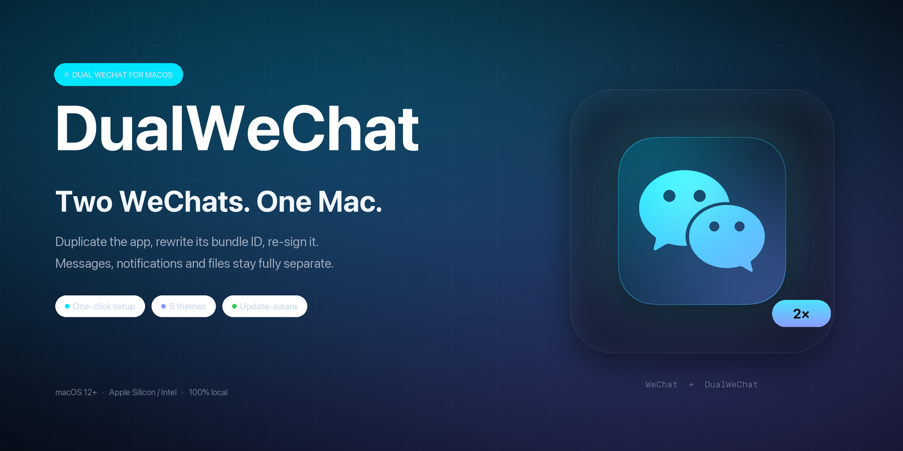
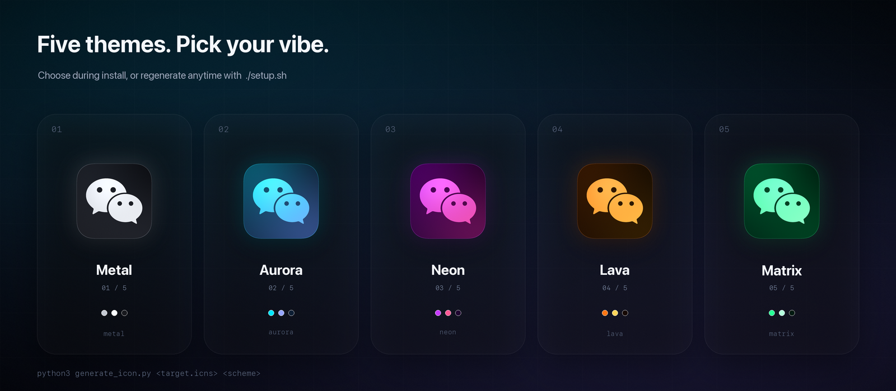

<div align="center">



<br />

<a href="https://github.com/MaiwulanjiangMaiming/DualWeChat"></a>
<a href="https://github.com/MaiwulanjiangMaiming/DualWeChat"></a>
<a href="https://www.apple.com/macos/"></a>
<a href="LICENSE"></a>
<a href="COMMERCIAL.md"></a>
<a href="https://github.com/MaiwulanjiangMaiming/DualWeChat/pulls"></a>

<br />

### Two WeChats. One Mac.

Duplicate WeChat, rewrite its bundle identifier, re-sign it — and let macOS treat the second copy as a genuinely separate app.

[Quick start](#quick-start) · [How it works](#how-it-works) · [Themes](#themes) · [FAQ](#faq) · [中文](README.md)

</div>

---

**DualWeChat** is a small macOS utility: it duplicates WeChat, writes a new bundle identifier and re-signs the copy, giving the second WeChat its own icon, notifications and data container. Everything runs locally — no injection and no modification of the WeChat binary.

## Why this exists

WeChat for macOS checks whether an instance is already running. Double-click the icon a second time and it simply brings the existing window forward instead of opening another WeChat.

The usual `open -n` / `nohup` tricks are caught by newer versions of WeChat. DualWeChat takes a different route:

> Don’t force a second window. Make the system believe a second app exists.

It copies `WeChat.app`, changes the copy’s bundle identifier to `com.tencent.xinWeChat.dual`, and signs it independently. macOS identifies apps by bundle ID, so the copy gets its own icon, name, notifications and sandbox container — and can run alongside the original.

### Compared with other approaches

| Approach | How it works | Result |
| --- | --- | --- |
| `nohup WeChat &` | Launch in the background | Newer WeChat detects the existing instance |
| `open -n WeChat.app` | Request a new instance | Also blocked |
| **Change the bundle ID** | Duplicate + new identity | macOS sees two apps; both can run |

---

## Features

| Capability | What it does |
| --- | --- |
| **Truly independent** | Not just another window: its own bundle ID, signature and sandbox container |
| **One-command setup** | Copy, rename, re-icon, re-sign and refresh the Dock automatically |
| **Ten icon themes** | Metal / Aurora / Neon / Lava / Matrix / Sakura / Ocean / Sunset / Grape / Crimson — choose at install time or switch later |
| **Update aware** | After WeChat updates, run `./update.sh` to detect the new version and rebuild |
| **Leaves the original alone** | Read-only copy; the official WeChat keeps its signature and updates normally |
| **100% local** | No network calls, no telemetry; scripts and icon generation are auditable |

---

## Quick start

**Requirements:** macOS 12 or later · WeChat 4.x installed · admin rights · ~1.4 GB free space.

```bash
git clone https://github.com/MaiwulanjiangMaiming/DualWeChat.git
cd DualWeChat
./setup.sh
```

The installer runs six steps and asks for your admin password once, when it needs to write to `/Applications`:

1. Copy `WeChat.app` to `DualWeChat.app`
2. Write the new bundle ID and disable the copy’s in-app updater
3. Rename the app (including localized resources)
4. Generate the icon theme you choose (optional)
5. Re-sign the copy
6. Refresh the Dock / Finder icon cache

When it finishes, **DualWeChat** appears in Launchpad. Sign in to account 1 with the original WeChat and account 2 with DualWeChat.

> If macOS blocks the first launch, right-click the app → **Open**, or allow it once under System Settings → Privacy & Security.

<details>
<summary>Advanced flags</summary>

```bash
./setup.sh --check              # inspect macOS / WeChat / dependencies, change nothing
./setup.sh --scheme aurora      # pick a theme without the menu
./setup.sh --keep-icon          # reuse the current copy's icon (default for updates)
./setup.sh --no-icon            # keep the original WeChat icon
./setup.sh --yes                # overwrite an existing copy without asking
./setup.sh --help               # all options
```

</details>

---

## How it works


1. **Copy** — create a full duplicate; the original stays untouched.
2. **New identity** — the bundle ID is what macOS uses to identify an app. Change it and the system treats the copy as a different app.
3. **Re-sign** — an ad-hoc signature lets the modified copy launch. The copy’s Sparkle updater is disabled so an in-app update cannot overwrite the dual-instance changes.

This is also why logins, chat history, notifications and icons stay separate: macOS gives each bundle ID its own sandbox container.

---

## Themes



Pick one during install, or regenerate anytime:

```bash
./setup.sh --scheme aurora
```

| Theme | Look | Best for |
| --- | --- | --- |
| `metal` | Metallic black | Understated, close to native macOS dark mode |
| `aurora` | Cold blue aurora | Most distinctive; recommended |
| `neon` | Purple-pink neon | Vivid, stands out on a light Dock |
| `lava` | Orange-gold lava | Warm and easy on the eyes at night |
| `matrix` | Terminal green | A hacker-terminal vibe |
| `sakura` | Soft pink | Light wallpapers and a softer Dock |
| `ocean` | Teal and sky blue | A calm, cool desktop |
| `sunset` | Coral and peach | Warm and energetic |
| `grape` | Violet and lilac | Purple without the neon glare |
| `crimson` | Deep red | Maximum contrast and visibility |

Generate an icon manually:

```bash
pip3 install Pillow numpy
python3 generate_icon.py /Applications/DualWeChat.app/Contents/Resources/AppIcon.icns aurora
```

> WeChat 4.1+ / macOS 26 prefers the original icon inside `Assets.car`, declared by `CFBundleIconName`. `setup.sh` removes that key and re-signs automatically; if you replace the icon by hand, do the same step.

---

## FAQ

<details>
<summary><strong>Is it safe? Will WeChat detect or ban my account?</strong></summary>

DualWeChat does not inject code, modify WeChat’s binary or read your messages. It only copies the app, edits the bundle identifier in `Info.plist`, and re-signs the copy. Everything happens locally.

That said, running two instances is an unofficial use of WeChat. Tencent may change its detection at any time. Use your own judgement, and be careful with accounts that matter. The project collects no data and makes no promises about account status.

</details>

<details>
<summary><strong>Will the two accounts share data?</strong></summary>

No. macOS isolates app containers by bundle ID, so the copy uses its own container at `com.tencent.xinWeChat.dual`. Logins, chat history and caches are separate.

The trade-off is roughly 1.4 GB of extra app space plus a second copy of your chat data.

</details>

<details>
<summary><strong>Can I tell which WeChat a notification came from?</strong></summary>

Yes. Notifications are grouped by app, and the two apps have different names and icons. You can also configure them separately under System Settings → Notifications.

</details>

<details>
<summary><strong>What happens after WeChat updates?</strong></summary>

In-app updates are disabled for the copy (a re-signed app cannot pass WeChat’s updater signature check). The flow is:

1. Update the original WeChat normally.
2. Run `./update.sh`.

The script compares version numbers, rebuilds DualWeChat when needed, quits a running copy first, and relaunches it afterwards.

</details>

<details>
<summary><strong>How is this different from <code>open -n</code>?</strong></summary>

Newer WeChat versions detect an existing instance themselves. `open -n` only asks macOS to launch the app again, and WeChat still refuses. Changing the bundle ID makes the copy a different app from the system’s point of view, so the single-instance check no longer applies across the two.

</details>

<details>
<summary><strong>Does it work on Intel Macs and macOS 12?</strong></summary>

The scripts support both Apple Silicon and Intel, and macOS 12 or later. WeChat 4.x has its own system requirements — check Tencent’s documentation. The macOS 26 icon-cache quirks are handled by the installer.

</details>

<details>
<summary><strong>Can I run three or more?</strong></summary>

In principle you can copy the app again with a different bundle ID, but this project only tests two instances. More copies take more space and may increase the unpredictability of account risk controls. Not recommended for daily use.

</details>

<details>
<summary><strong>Does uninstalling delete my chat history?</strong></summary>

`rm -rf /Applications/DualWeChat.app` only removes the app. To remove the second account’s local data as well, delete its container after making sure you no longer need it:

```bash
rm -rf ~/Library/Containers/com.tencent.xinWeChat.dual
```

Back up important chats first.

</details>

---

## Troubleshooting

| Symptom | Fix |
| --- | --- |
| “Cannot be opened because the developer cannot be verified” | Right-click the app → **Open**, or allow it once under System Settings → Privacy & Security |
| The icon is still the original WeChat icon | Run `./setup.sh` again; if the cache persists, log out or restart, or run `killall Dock` |
| Permission error during install | Run it in Terminal rather than double-clicking in Finder; make sure your account is an admin |
| DualWeChat won’t open after an update | Update the original WeChat first, then run `./update.sh` |
| Signing in to the same account kicks the other instance offline | That is WeChat’s device limit, not a dual-instance bug; use two different accounts |
| Signing fails | Check free disk space and re-run `./setup.sh`; if it still fails, open an issue with the terminal output |

---

## Updating

```bash
./update.sh          # check and update
./update.sh --check  # check only; exit code 10 means an update is available
```

Updates keep the current icon. To switch themes, run `./setup.sh --scheme aurora`; when versions match you can also choose “reinstall / change icon”.

---

## Uninstall

```bash
sudo rm -rf /Applications/DualWeChat.app
```

To remove the second account’s local data too, see “Does uninstalling delete my chat history?” above.

---

## Manual install

<details>
<summary>Prefer not to use the script? Here is every step.</summary>

```bash
# 1. Copy WeChat
sudo cp -R /Applications/WeChat.app /Applications/DualWeChat.app
sudo chown -R "$USER:$(id -gn "$USER")" /Applications/DualWeChat.app

# 2. Change the bundle ID
sudo /usr/libexec/PlistBuddy \
    -c "Set :CFBundleIdentifier com.tencent.xinWeChat.dual" \
    /Applications/DualWeChat.app/Contents/Info.plist

# 3. Rename
sudo /usr/libexec/PlistBuddy \
    -c "Set :CFBundleDisplayName DualWeChat" \
    /Applications/DualWeChat.app/Contents/Info.plist
sudo /usr/libexec/PlistBuddy \
    -c "Set :CFBundleName DualWeChat" \
    /Applications/DualWeChat.app/Contents/Info.plist

# 4. Disable in-app updates for the copy
for key in SUEnableAutomaticChecks SUAllowsAutomaticUpdates SUAutomaticallyUpdate; do
    sudo /usr/libexec/PlistBuddy \
        -c "Add :$key bool false" \
        /Applications/DualWeChat.app/Contents/Info.plist 2>/dev/null || true
    sudo /usr/libexec/PlistBuddy \
        -c "Set :$key false" \
        /Applications/DualWeChat.app/Contents/Info.plist
done

# 5. Generate and install an icon (optional)
pip3 install Pillow numpy
python3 generate_icon.py /tmp/AppIcon.icns aurora
sudo cp /tmp/AppIcon.icns /Applications/DualWeChat.app/Contents/Resources/AppIcon.icns
sudo /usr/libexec/PlistBuddy \
    -c "Delete :CFBundleIconName" \
    /Applications/DualWeChat.app/Contents/Info.plist 2>/dev/null || true

# 6. Re-sign and refresh the Dock
sudo codesign --force --deep --sign - /Applications/DualWeChat.app
sudo touch /Applications/DualWeChat.app
killall Dock
```

</details>

---

## Contributing

- **Found a bug?** Check the FAQ and troubleshooting sections first, then open an [issue](https://github.com/MaiwulanjiangMaiming/DualWeChat/issues) with your macOS version, WeChat version and terminal output.
- **Want to change code?** PRs are welcome. Open an issue first for larger changes; before submitting, run `bash -n setup.sh update.sh` and test a real install.
- **Want to change the artwork?** Run `python3 tools/build_assets.py` to regenerate everything in `assets/` from the local WeChat icon.
- **If this saved you some time**, a ⭐ is the best way to say thanks.

## Credits

Inspired by [CLOUDUH/dual-wechat](https://github.com/CLOUDUH/dual-wechat). This project targets newer WeChat single-instance detection with a bundle ID + independent signature approach, and adds icon themes, update tooling and macOS 26 compatibility.

The WeChat logo is a trademark of Tencent. DualWeChat is not affiliated with Tencent.

## Commercial use

This project is licensed for **personal, non-commercial use only**. Any commercial use — including resale, paid distribution, preinstallation, commercial delivery, or paid installation, maintenance or support — requires **prior written permission from the author** under [CC BY-NC 4.0](LICENSE).

Contact [@MaiwulanjiangMaiming](https://github.com/MaiwulanjiangMaiming) or see [COMMERCIAL.md](COMMERCIAL.md).

## License

[CC BY-NC 4.0](LICENSE) © Maiwulanjiang Maiming

Free for personal, non-commercial use with attribution under CC BY-NC 4.0. Commercial use requires a separate license from the author.

<div align="center">
<br />
<sub>If DualWeChat helped you, please consider starring the repo ⭐ and sharing it with someone who needs it.</sub>
</div>
